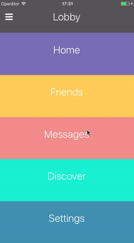
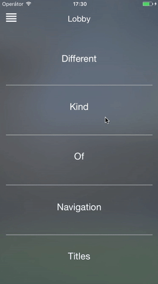

# Lobby

A navigation concept I played with after UIStackView came out in iOS 9. Instead of a tab bar or a side menu, all sections sit in one stack. Tap one and it springs open to full screen, tap the menu icon and they all come back.

  
  

I wrote about how it works here: [Adopting UIStackView](https://medium.com/@potocek.patrik/adopting-uistackview-fe330577d8d2)

Short version: the stack view does all the layout, so hiding the other rows inside a spring animation is pretty much everything. It doesn't tell you which view was tapped though, so `CustomStackView` adds a tap recognizer to each arranged subview and sends the index to its delegate.

There are two versions, `CardsLobbyViewController` with colored cards and `BlurLobbyViewController` with titles over a blurred photo.

Swift 3, iOS 9.
